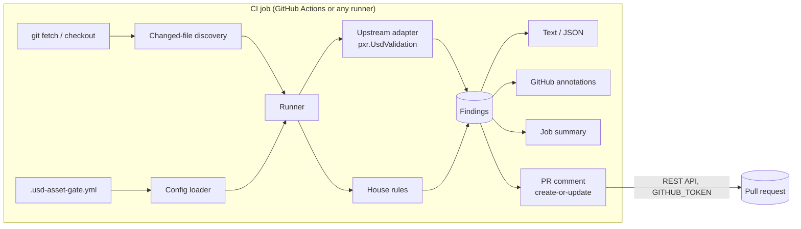

# usd-asset-gate — Architecture

> Status: MVP implemented (milestones M1–M8). This document describes the code as built;
> the post-MVP sections are still plans. API names for OpenUSD were checked against
> `usd-core` 26.8 (OpenUSD v26.08) on 2026-10-17.

## Overview



Everything to the right of "git fetch" is the Python package; everything above it is a thin
shell layer, so the same core runs from a laptop, a pre-commit hook or any CI system.

## Components

| Component | Module | Responsibility |
|---|---|---|
| CLI | `usd_asset_gate/cli.py` | `argparse` front end: `check`, `rules`, `comment`, `preview`. Exit codes 0 / 1 / 2 (`preview` never exits 1). |
| Finding model | `model.py` | `Finding`, `Severity`, `Report`; stable ordering; exit code from `fail_on`. |
| Runner | `runner.py` | Opens each file once, runs every enabled rule, collects and sorts findings. A file that cannot be opened at all is reported under the built-in rule `stage-open` (code `StageOpenFailed`). |
| Config loader | `config.py` | Find and parse `.usd-asset-gate.yml`, validate against the schema, merge defaults and per-path overrides. |
| Discovery | `discovery.py` | Expand paths and globs; `--changed-since <ref>` via `git diff`; filter by extension and `include`/`exclude`. |
| Stage loader | `stage.py` | Open each file once (`Usd.Stage.Open`), capture composition diagnostics, compute stats once, hand a shared `AssetContext` to every rule. |
| Upstream adapter | `rules/upstream.py` | Build a `UsdValidation.ValidationContext` from the selected validators, run it, map `ValidationError` to `Finding`. |
| House rules | `rules/house/*.py` | One module per rule (`stage_metadata`, `default_prim`, `file_size`, `prim_budget`, `instance_budget`, `prim_naming`). |
| Rule registry | `rules/registry.py` | Rule IDs, defaults, parameter schemas, the alias table to upstream validators (each alias *claims* specific upstream errors). |
| Reporters | `report/{text,json,github,summary}.py` | Render findings for each output. |
| PR commenter | `report/comment.py` | Create-or-update one PR comment with `urllib.request`. |
| Preview (advisory) | `preview/{flatten,strata,compare,run}.py`, `report/previews.py` | Before/after images of changed assets rendered headless by Strata, compared with Strata's ΔE policy. Imported only by `preview` and `comment --previews`. See [Preview](#preview-strata-headless-advisory). |
| Shell layer | `action.yml`, `ci/usd-asset-gate.sh` | Checkout, install, invoke the CLI; no logic beyond plumbing. |

## Data flow for one run

1. **Config.** Load `.usd-asset-gate.yml` from the repo root (or `--config`). Unknown keys or
   wrong types stop the run with exit 2 before any asset is opened.
2. **Discovery.** Resolve the file list. In PR mode (`--changed-since <ref>`): `git diff
   --name-only -z --diff-filter=ACMR <ref>...HEAD`, keep `*.usd, *.usda, *.usdc, *.usdz`
   (case-insensitive), apply `include`/`exclude`, and, when paths are also given, keep only
   files under them. Deleted files are ignored. A ref that is not in the clone exits 2 with
   a `git fetch` hint.
3. **Per file** (one file at a time in the MVP; OpenUSD's validation context runs the
   validators for that file in parallel):
   1. `file-size` is checked from `os.stat` *before* opening, so a huge file fails fast.
   2. Open the stage with `Usd.Stage.Open`. A `Tf.ErrorException` (syntax error, missing
      file, compressed `.usdz`) becomes a `stage-open` / `StageOpenFailed` finding. What
      OpenUSD's C++ code prints to stderr while opening and validating — composition
      warnings such as "Could not open asset …" or "Could not load sublayer …" — is
      captured at file-descriptor level and kept per file as `diagnostics` in the JSON
      report (printed with `check --verbose`) rather than only scrolling past in the log.
      The composition problems themselves are reported as findings by the upstream
      `usdValidation:CompositionErrorTest` validator.
   3. Compute `UsdUtils.ComputeUsdStageStats(stage)` once.
   4. Run the upstream adapter, then every enabled house rule, against the shared context.
4. **Collect** `Finding`s, apply severity overrides, sort by file / severity / rule.
5. **Report** to every requested output; compute the exit code from `fail_on`.

## Finding model

```python
@dataclass(frozen=True)
class Finding:
    rule: str            # "prim-budget" or "upstream:usdGeomValidators:StageMetadataChecker"
    code: str            # stable error name, e.g. "MissingUpAxisMetadata", "PrimBudgetExceeded"
    severity: Severity   # error | warning | info
    file: str            # repo-relative path of the checked root layer
    message: str
    prim_path: str | None = None
    layer: str | None = None      # layer that holds the problem, if not the root
    line: int | None = None       # .usda only, best effort
    fixer_available: bool = False # upstream fixer exists (reported, never applied)
```

`code` comes straight from `ValidationError.GetName()` for upstream findings, so users can
search OpenUSD docs for it.

## Rule engine design

- **Two rule sources, one interface.** Every rule implements
  `check(ctx: AssetContext, params) -> Iterable[Finding]`. The upstream adapter is a single
  rule source that expands into one entry per OpenUSD validator in the registry, named
  `upstream:<plugin>:<validator>`.
- **Upstream run failures.** `ValidationContext.Validate` is retried when OpenUSD raises a
  `Tf` error from inside the validators (seen with `usd-core` 25.8 on 2026-10-17: a race
  registering UsdShade connectable behaviour when validators run in parallel); if it keeps
  failing, the file gets one `upstream` / `ValidationRunFailed` error finding.
- **Fixers.** `fixer_available` is set when `ValidationError.GetFixers()` returns any fixer.
  That method exists from `usd-core` 26.x (it is absent in 25.8, where the flag is always
  false). Fixers are never applied.
- **Upstream discovery is dynamic.** The adapter lists
  `UsdValidation.ValidationRegistry().GetAllValidatorMetadata()` at runtime, so new
  validators in newer `usd-core` releases appear without a release of this tool. In
  `usd-core` 26.8 the registry holds 28 validators (core, UsdGeom, UsdShade, UsdSkel,
  UsdLux, UsdPhysics, UsdUtils/usdz); 25.8 holds 24.
- **Aliases.** Friendly names map onto upstream validators so configs read naturally:

  | Alias | Upstream validator(s) / error names |
  |---|---|
  | `unresolved-references` | `usdUtilsValidators:MissingReferenceValidator`, `usdValidation:CompositionErrorTest` (reference errors) |
  | `unresolved-sublayers` | `usdValidation:CompositionErrorTest` (sublayer errors), `usdUtilsValidators:MissingReferenceValidator` |
  | `default-prim` | `usdValidation:StageMetadataChecker` (`MissingDefaultPrim`), plus an optional house `kind` check |
  | `stage-metadata` | `usdGeomValidators:StageMetadataChecker` (presence), plus house value checks |

  When both an alias and its upstream validator are enabled, the finding is reported once,
  under the alias. An enabled alias runs the validators it claims even when `upstream`
  selection leaves them out; a disabled alias hands those errors back to the upstream rule
  (if selected), so silencing a check entirely means disabling both. `unresolved-*` findings
  are grouped by the unresolved asset path and carry the code `UnresolvableDependency`;
  `default-prim` and `stage-metadata` keep the upstream code.
- **House rules only add what upstream lacks.** Upstream checks that `upAxis` and
  `metersPerUnit` are *present*; the house rule checks they have the *required values*.
  Budgets, naming and file size have no upstream equivalent.
- **House rule details, as implemented.** A rule with no limits configured checks nothing,
  so the defaults never fail a valid asset.
  - `stage-metadata` compares authored values only (`UsdGeom.StageHasAuthoredMetersPerUnit`,
    `stage.HasAuthoredMetadata("upAxis")`); a missing value is the upstream presence error.
    `tolerance` is absolute (default `1e-9`). Codes `MetersPerUnitMismatch`, `UpAxisMismatch`.
  - `default-prim.kind` uses `Kind.Registry.IsA`, so a kind derived from the required one
    passes (`assembly` satisfies `model`, not `component`). Code `DefaultPrimKindMismatch`,
    with the default prim's path.
  - `file-size.max_bytes` takes bytes, a size string (`KB`/`MB`/`GB` are powers of 1000,
    `KiB`/`MiB`/`GiB` powers of 1024), or a mapping from `.usd`/`.usda`/`.usdc`/`.usdz` or
    `default` to a size. An oversize file gets `FileTooLarge` and is not opened; no other
    rule runs on it.
  - `prim-budget` and `instance-budget` read `UsdUtils.ComputeUsdStageStats`, computed once
    per file and shared. `max_prims` is checked against `totalPrimCount` (composed prims
    plus instancing prototypes, no pseudo-root); `max_by_type` against the primary plus
    prototype `primCountsByType`. `max_prototypes` is checked against `prototypeCount`;
    `min_instance_ratio` against `instancedModelCount / modelCount` (instanced models over
    instanced plus uninstanced models), skipped when the stage has no models. Both default
    to `warning`. Codes `PrimBudgetExceeded`, `PrimTypeBudgetExceeded`,
    `PrototypeBudgetExceeded`, `InstanceRatioTooLow`.
  - `prim-naming` visits `stage.Traverse()` (active, loaded, defined, non-abstract prims;
    instance proxies are not visited). Patterns are tried in order; `match.type` is a glob
    on the type name (`"*"` also matches untyped prims), `match.path` a path glob on the
    prim path; the first pattern that matches decides, and its `regex` is applied with
    `re.search`. An invalid regex exits 2 naming the key. Each offending prim is a
    `PrimNameMismatch` finding with its path, up to `max_findings` per file (default 50);
    the rest are summarised in one `info` finding, `PrimNamingFindingsCapped`.
- **Severity.** Each rule has a default severity; config can override it. `fail_on`
  (default `error`) sets the threshold for exit code 1. Upstream `ValidationErrorType`
  maps Error→error, Warn→warning, Info→info.
- **Determinism.** Rules never mutate the stage; output order is stable so PR comments only
  change when findings change.

## Configuration schema

File: `.usd-asset-gate.yml` at the repository root. Every key is optional.

```yaml
version: 1

include: ["assets/**"]              # default: all USD files
exclude: ["assets/legacy/**", "**/*_wip.usda"]
fail_on: error                      # error | warning | info | never

upstream:
  enabled: true
  validators: []                     # names or globs to run; empty with no keywords = all
  keywords: [UsdCoreValidators, UsdGeomValidators, UsdShadeValidators, UsdUtilsValidators]
  disable: ["usdPhysicsValidators:*"]   # names or globs

rules:
  unresolved-references: { severity: error }
  unresolved-sublayers:  { severity: error }
  default-prim:
    severity: error
    kind: component                  # optional: required Kind on the default prim
  stage-metadata:
    severity: error
    metersPerUnit: 0.01
    upAxis: Y
    tolerance: 1.0e-9
  file-size:
    severity: error
    max_bytes: { default: 50MB, .usdz: 200MB, .usda: 5MB }
  prim-budget:
    severity: warning
    max_prims: 50000
    max_by_type: { Mesh: 5000 }
  instance-budget:
    severity: warning
    max_prototypes: 200
    min_instance_ratio: 0.5          # instancedModelCount / modelCount
  prim-naming:
    severity: warning
    patterns:
      - match: { type: "*" }
        regex: "^[A-Za-z][A-Za-z0-9_]*$"
      - match: { type: Material }
        regex: "^M_[A-Za-z0-9_]+$"

overrides:
  - paths: ["assets/environments/**"]
    rules:
      prim-budget: { max_prims: 2000000 }
```

The schema is defined once in Python (`config.py`, built from the rule registry) and
published as JSON Schema (`schema/usd-asset-gate.schema.json`, regenerated with
`python -m usd_asset_gate.config`; a test fails when the two drift) for editor completion.
Validation uses the standard library only, so the runtime dependencies stay at `usd-core`
and `PyYAML`. Errors name the key path, for example
`rules.prim-budget.max_prims: expected integer, got string` or
`rules.prim-budgt: unknown rule`, and exit 2.

Resolution rules, as implemented:

- **File lookup.** `--config <file>`, else `.usd-asset-gate.yml` in the working directory,
  else built-in defaults. An empty file means defaults.
- **Upstream names.** Exact validator names under `upstream.validators`/`upstream.disable`
  and `upstream:<plugin>:<validator>` keys under `rules` must exist in the installed
  `usd-core`; globs may match nothing. A rule entry `{enabled: true}` adds a validator the
  selection left out, `{enabled: false}` removes one.
- **Globs.** `include`, `exclude` and `overrides[].paths` match the whole forward-slash path
  relative to the working directory; `**` spans directories (`**/` also matches none),
  `*` and `?` stay within one path segment. `include`/`exclude` filter files found by
  walking a directory and the files found by `--changed-since`; a file named explicitly on
  the command line is always checked.
- **Overrides.** Defaults, then `rules`, then every matching `overrides` entry in file
  order; each layer replaces settings key by key, one level deep (a whole `max_by_type`
  mapping is replaced, not merged).
- **`fail_on`.** `--fail-on` on the command line beats the config value.

## Output formats

| Output | Flag | Notes |
|---|---|---|
| Text | default | `path[:line][:prim]: severity rule: message [code]` plus a PASS/FAIL line, coloured on a TTY (`NO_COLOR` respected). |
| JSON | `--format json`, or `--json <file>` alongside any format | `{ "version": 1, "tool": {...}, "files": [{path, findings, diagnostics}], "findings": [...], "summary": {...} }`; stable, documented, used by the comment step. |
| GitHub annotations | `--format github` | `::error` / `::warning` / `::notice` `file=<path>,line=<n>,title=usd-asset-gate: <rule>::<message>` workflow commands, escaped as `@actions/toolkit` does (`%`, CR, LF in data; also `:` and `,` in properties), followed by the text report for the log, wrapped in `::stop-commands::<random token>` … `::<token>::` so file names or messages from the pull request cannot forge workflow commands. GitHub shows only a limited number of annotations per step and the workflow-commands page does not state the number (checked 2026-10-18), so the reporter emits the most severe first, at most 10 per severity by default (`--max-annotations N`), then one notice counting the rest. `line` is filled best-effort for `.usda` root layers by following the prim hierarchy through the text (each path component must be a direct child of the previous one, outside strings, comments and metadata); when that cannot be established, `line` stays unset. |
| Job summary | `--summary <file>` | Appends Markdown to `$GITHUB_STEP_SUMMARY`: verdict and totals, a table of files with findings, a count of clean files, and a findings table in a `<details>` block. GitHub limits each step's summary to 1 MiB (workflow-commands docs, checked 2026-10-18); the renderer keeps under 960 KiB by dropping finding rows and saying how many were left out. |
| PR comment | `usd-asset-gate comment --from report.json` | One comment per PR, found by the hidden marker `<!-- usd-asset-gate:report -->` and edited with `PATCH /repos/{owner}/{repo}/issues/comments/{id}`; created with `POST …/issues/{n}/comments` if absent. When all findings clear, the comment is edited to a short "all checks pass" note, not deleted, so the history stays readable. Requires `pull-requests: write` (or `issues: write`). Comments are listed with `per_page=100`, following `Link: rel="next"`; the comment whose body starts with the marker is edited. A run that checked no USD files only edits an existing comment and never starts one. Bodies stay under GitHub's 65,536-character limit by dropping finding rows with a link to the workflow run. With no token, no `GITHUB_REPOSITORY` or no PR number (from `GITHUB_EVENT_PATH` or `--pr`), or on `401`/`403` (for example, a PR from a fork, where `GITHUB_TOKEN` is read-only) it logs why and exits 0; any other HTTP failure exits 2. The command does not import `pxr`; the log, annotations and job summary still carry the results. `pull_request_target` is never used to work around this (see [Decisions](#decisions)). |

## Running in GitHub Actions

### Mode A — composite action

```yaml
- uses: actions/checkout@v7            # or the plain-git step below
  with: { fetch-depth: 0 }
- uses: Preponderous-Software/usd-asset-gate@<full-commit-sha>
  with:
    config: .usd-asset-gate.yml
    usd-core-version: "26.8"
    comment: true
```

The composite action itself uses no other actions: its single step runs
`ci/usd-asset-gate.sh` with `bash`, installing `usd-core` and the action's own source tree
with `pip`, so pinning it by commit SHA pins everything. Inputs: `config`,
`usd-core-version`, `paths`, `comment`, `fail-on`, `base-sha` (default: the pull request's
base SHA) and `github-token` (default: `github.token`). A full example is in
[`examples/workflow-action.yml`](examples/workflow-action.yml).

### Mode B — local-only (no third-party `uses:`)

For organisations whose policy allows only actions in their own repositories. The consumer
copies `ci/usd-asset-gate.sh` into their repo (it is MIT-licensed and short enough to
review) and writes:

```yaml
on:
  pull_request:
    paths: ["**/*.usd", "**/*.usda", "**/*.usdc", "**/*.usdz", ".usd-asset-gate.yml"]
permissions:
  contents: read
  pull-requests: write
jobs:
  usd-gate:
    runs-on: ubuntu-24.04
    steps:
      - name: Checkout (plain git)
        env:
          TOKEN: ${{ github.token }}
        run: |
          git init -q .
          git remote add origin "https://github.com/${GITHUB_REPOSITORY}.git"
          git -c http.extraheader="AUTHORIZATION: basic $(printf 'x-access-token:%s' "$TOKEN" | base64 -w0)" \
            fetch -q --no-tags origin "${{ github.event.pull_request.base.sha }}" "${GITHUB_SHA}"
          git checkout -q --detach "${GITHUB_SHA}"
      - name: USD asset gate
        env:
          GITHUB_TOKEN: ${{ github.token }}
          BASE_SHA: ${{ github.event.pull_request.base.sha }}
        run: bash ci/usd-asset-gate.sh
```

The complete file is [`examples/workflow-local-only.yml`](examples/workflow-local-only.yml).
`ci/usd-asset-gate.sh` then:

1. makes sure `BASE_SHA` is present (fetching it, and unshallowing if there is no merge
   base, with the token as a one-off `http.extraheader`);
2. creates a virtualenv under `$RUNNER_TEMP` (system Pythons on current runners refuse
   `pip install`) and installs `usd-core==${USD_CORE_VERSION:-26.8}` and
   `$USD_ASSET_GATE_SPEC` — a version pin once published, a vendored source tree such as
   `./vendor/usd-asset-gate`, or a git URL pinned to a commit (the default is the upstream
   repository at `main`, and the script prints a reminder to pin it);
3. runs `usd-asset-gate check --changed-since "$BASE_SHA" --format github
   --summary "$GITHUB_STEP_SUMMARY" --json "$RUNNER_TEMP/usd-asset-gate-report.json"`
   (`USD_ASSET_GATE_PATHS`, `USD_ASSET_GATE_CONFIG` and `USD_ASSET_GATE_FAIL_ON` adjust it;
   without `BASE_SHA` it checks the given paths or the whole repository);
4. runs `usd-asset-gate comment --from …` unless `USD_ASSET_GATE_COMMENT=false`; a comment
   failure becomes a warning annotation and never changes the result;
5. exits with the `check` exit code.

The token is passed through `http.extraheader` for the fetch only and is never written into
`.git/config`; this repository's dogfood workflow asserts that after the run.

## Dependencies

| Dependency | Version | Why |
|---|---|---|
| Python | 3.10–3.13 (CI matrix); `usd-core` 26.8 wheels exist for 3.9–3.14 | Runtime. |
| [`usd-core`](https://pypi.org/project/usd-core/) | `>=25.08` supported, `26.8` tested and default | `pxr.Usd`, `pxr.UsdUtils`, `pxr.UsdValidation`. `UsdValidation` ships in wheels from 25.02; 25.08 is where `usdchecker` made the framework its default, so it is the floor. Note: the wheel contains no `usdchecker`/`usdrecord` executables and no imaging modules. |
| [`PyYAML`](https://pypi.org/project/PyYAML/) | `>=6.0` (6.0.3 current) | Config parsing (`yaml.safe_load` only). |
| `pytest` | `>=8` (dev only) | Tests. |
| `git` | any recent | Changed-file discovery; must be on `PATH` (it is on GitHub-hosted runners). |

No other runtime dependencies: HTTP calls use `urllib.request`, schema validation is
hand-written. The post-MVP `[nvidia]` extra (see [Optional NVIDIA rule source](#optional-nvidia-rule-source))
is opt-in and never imported by the core. Neither is the `[preview]` extra (numpy, plus a
Strata `libstrata.so` and Mesa's EGL/llvmpipe on the machine), used only by `preview`.

## Testing strategy

- **Fixture corpus** under `tests/fixtures/`:
  - `pass/` — minimal valid assets in `.usda`, `.usdc` and `.usdz`, including a referenced
    sub-asset that resolves and an instanced set.
  - `fail/<case>/` — one defect per directory. Present now: `missing_reference`,
    `missing_sublayer`, `no_default_prim`, `no_up_axis` (also no `metersPerUnit`),
    `missing_material_binding_api` (an upstream error with a fixer), `unparseable`,
    `usdz_compressed` (cannot be opened), `usdz_misaligned`, `wrong_meters_per_unit`,
    `wrong_up_axis`, `wrong_kind`, `over_prim_budget`, `low_instancing` and
    `bad_prim_names`; an oversize file is generated at test time, not committed. A case
    that needs non-default settings carries its own `.usd-asset-gate.yml`. Each has
    `expected.json`
    listing the rule IDs and codes
    that must be reported — no more, no fewer. The convention, as implemented in
    `tests/test_fixtures.py`: `expected.json` holds
    `{"description": "...", "findings": [{"rule": "...", "code": "..."}]}`; every USD file
    in the case directory is checked together and the reported `(rule, code)` pairs must
    equal that list as a multiset.
  - `.usdc`/`.usdz` fixtures are generated from `.usda` sources (or, for the broken
    packages, written with `zipfile`) by `tests/fixtures/build.py`, which
    `tests/conftest.py` runs before collection. The outputs are git-ignored, so the
    repository holds only text sources and the binaries are reproducible from them.
- **Unit tests** per rule with in-memory stages (`Usd.Stage.CreateInMemory`) for boundary
  values (budget at N and N+1, regex edge cases, tolerance on `metersPerUnit`).
- **Golden output tests** for text, JSON, GitHub annotations and Markdown summary.
- **Comment tests** against a fake GitHub API (`http.server` in a thread) covering create,
  update, "all clear" edit and the 403 fork case.
- **Version matrix**: CI runs on the minimum and latest supported `usd-core`, so upstream
  validator changes show up as test failures rather than surprises.
- **Dogfooding**: `.github/workflows/usd-gate.yml` runs the local-only mode exactly as a
  consumer would (plain-git checkout, `bash ci/usd-asset-gate.sh`, PR comment) on the USD
  files a pull request changes, using this repository's `.usd-asset-gate.yml` (which
  includes only `tests/fixtures/pass/**`). It then checks all of `tests/fixtures/pass/`
  (must pass), every `tests/fixtures/fail/<case>/` with its own config (each must exit 1),
  and that no `http.extraheader` was left in `.git/config`. A second job runs the composite
  action from the checkout (`uses: ./`). Fail cases whose defect is only a violation of
  their own config (`wrong_meters_per_unit`, `wrong_kind`, `over_prim_budget`,
  `low_instancing`) would pass under the repository config if moved into `pass/`; every
  other fail case would turn the pass step red.

## Post-MVP roadmap

None of this is started until the MVP acceptance criteria in [MVP.md](MVP.md) are met. Each
item follows from a decision recorded under [Decisions](#decisions).

### Thumbnails (full OpenUSD container)

Render a thumbnail per changed asset and link it from the PR comment. The `usd-core` wheel
includes no Hydra/imaging modules and no `usdrecord`, so the thumbnail step runs in a
**Docker image with a full OpenUSD build** that provides `usdrecord`. The image is used only
for this optional step; the gate itself keeps running on `pip install usd-core`.

- **Image build.** A `Dockerfile` in this repository (planned path
  `docker/thumbnails/Dockerfile`) builds OpenUSD from the upstream source tag with its own
  `build_scripts/build_usd.py`, with imaging and Python enabled, and installs
  `usd-asset-gate` alongside it. Rendering is headless with software OpenGL (for example
  Mesa's llvmpipe under a virtual X server); the exact renderer setup is to be verified when
  the image is first built, not assumed.
- **Pinned OpenUSD version.** The OpenUSD release is a build argument pinned to one tag
  (initially `v26.08`, matching the default `usd-core` 26.8), and is bumped together with the
  default `usd-core` version so thumbnails and validation see the same OpenUSD. Base images
  are pinned by digest. A published image is referenced by digest, never by a moving tag.
- **Cost.** A full OpenUSD build with imaging is slow to compile and produces a large image,
  so it is built once per pinned version and published (for example to GHCR under this
  repository), not built on every pull request. Pulling and rendering add time to each
  run, so the step is opt-in, runs as a separate job, and runs only when the PR changed USD
  files.
- **Local-only constraint still respected.** The image is a container, not an action: the
  workflow fetches it with a plain `docker pull <image>@sha256:<digest>` (or builds it with
  `docker build` from the copied-in `Dockerfile`, for organisations that allow no external
  images) and runs it with `docker run` in a `run:` step. No `uses:` line is added, in either
  the composite action or the local-only workflow. Assets from the PR are mounted read-only
  and the render runs with `--network none`, since the assets are untrusted input.
- **Where images live.** Images cannot be attached to PR comments through the REST API, so
  they have to be uploaded as a workflow artifact or committed to a branch and linked. That
  choice is still open (see [Open questions](#open-questions)).

### Preview (Strata headless, advisory)

Accepted on 2026-10-23 (RFC 0028 in Preponderous-Software/rfcs; see
[Decisions](#decisions) 5). A light tier that sits **beside** the thumbnail plan above; it
does not replace it.

`usd-asset-gate preview --changed-since <ref> --out DIR --json previews.json` renders each
changed root layer twice from the same cameras: as composed at the merge base of `<ref>`
and `HEAD` (a temporary detached `git worktree`, removed afterwards) and as composed now.
A new file has only "after", a deleted one only "before". Files that merely reference a
changed file are not rendered.

- **USD → triangles in Python** (`preview/flatten.py`, `usd-core` only). Meshes are
  fan-triangulated (control cage; `leftHanded` honoured); `Cube`, `Sphere`, `Cylinder`,
  `Cone`, `Capsule` and `Plane` are tessellated here, because the `usd-core` wheel has no
  `GeomUtil` or `UsdImaging`. `PointInstancer` prototypes are drawn at every instance;
  instance proxies are traversed. Invisible prims and `guide` purpose are skipped (and
  `proxy` when the stage has `render` geometry). Colour is `displayColor` (any
  interpolation, inherited from ancestors), else a constant `UsdPreviewSurface`
  `diffuseColor`, else grey. Vertices are split per face (flat shading); Z-up stages are
  rotated to Y-up. Over `preview.max_triangles` the file gets a "too large" note.
- **Rendering** (`preview/strata.py`): `ctypes` over Strata's versioned C ABI, with every
  struct size checked against `strata_struct_size` at load. Headless (EGL surfaceless),
  `STRATA_LIGHTING_LEGACY`, 40° vertical field of view, views `three_quarter` and
  `three_quarter_back` by default (`top`, `front` optional), 640 × 360, framed on the union
  of the before and after bounds. Strata writes linear colour; the readback is sRGB-encoded.
- **Comparison** (`preview/compare.py`): Strata's golden-image policy ported to numpy —
  CIE76 ΔE in L\*a\*b\*, a pixel differs above 4.0, "no visible change" up to 0.5 % of
  pixels — and its red diff picture. Each view gets before, after, diff and a
  before | after | diff strip.
- **Report:** `previews.json`, a "Visual changes (advisory)" Markdown section (stdout and
  `--summary`), and `comment --from report.json --previews previews.json` appends the same
  section to the one PR comment. The section always lists what is not drawn.
- **Exit code:** 0 whatever the images show and when Strata cannot start ("preview
  unavailable"); 2 only on a usage or config error. Opt-in with `preview.enabled: true`
  (config `version: 2`) or `--force`.
- **Images:** written to `--out`. A workflow that allows `uses:` can upload them with
  `actions/upload-artifact`; a plain `run:` step cannot upload an artifact, so in the
  local-only mode they stay on the runner and the job summary carries the numbers. This
  repository's own CI does the latter (`preview (Strata headless)` job).
- **Getting Strata without `uses:`:** `curl` the release's `libstrata-<v>-linux-x64.so`,
  check it against the pinned SHA-256, install `libegl1 libegl-mesa0 libgl1-mesa-dri`, and
  set `STRATA_LIBRARY`, `LIBGL_ALWAYS_SOFTWARE=1`, `GALLIUM_DRIVER=llvmpipe`. Linux x64 only.

### Distribution (PyPI and GitHub Marketplace)

Once the MVP works, the package is published to PyPI as `usd-asset-gate` (the name was
unclaimed on 2026-10-17) and the composite action is listed on the GitHub Marketplace. The
MVP code is written to be publishable (complete `pyproject.toml` metadata, an `action.yml`
with Marketplace-compatible `name`/`description`/`branding`), but no release is made as part
of an MVP milestone. Local-only users are unaffected: they can still copy in
`ci/usd-asset-gate.sh` and pin a version or vendor the source tree.

### Optional NVIDIA rule source

`usd-validation-nvidia` is offered as an optional extra, installed with
`pip install usd-asset-gate[nvidia]`, and plugged in behind the same rule interface as the
upstream adapter. The core runtime dependencies stay `usd-core` and `PyYAML`; nothing in the
core imports the extra, and a config that enables NVIDIA rules without the extra installed
exits 2 with an install hint.

## Decisions

Recorded on 2026-10-17 by the project owner; each one closes a former open question.

1. **Thumbnails use a full OpenUSD container.** A Docker image with a full OpenUSD build
   provides `usdrecord` for the optional, post-MVP thumbnail step; a lightweight non-Hydra
   preview path is not pursued. Details under
   [Thumbnails](#thumbnails-full-openusd-container). Where the images are stored is still
   open.
2. **Fork pull requests: no comment in the MVP.** On a PR from a fork, where `GITHUB_TOKEN`
   is read-only, the comment step logs why it skipped and exits 0; the job log, annotations
   and job summary still show the results. `pull_request_target` is not used, and no
   `workflow_run` follow-up job is added for the MVP.
3. **Distribution: PyPI and GitHub Marketplace after the MVP.** Publish `usd-asset-gate` to
   PyPI and list the action on the Marketplace once the MVP works. This is a post-MVP
   roadmap item, not an MVP milestone. Details under
   [Distribution](#distribution-pypi-and-github-marketplace).
4. **NVIDIA `usd-validation-nvidia` is an optional extra, post-MVP.** Installed as
   `usd-asset-gate[nvidia]`; core runtime dependencies stay `usd-core` + `PyYAML` only.
   Details under [Optional NVIDIA rule source](#optional-nvidia-rule-source).

Recorded on 2026-10-23 by the project owner, who accepted RFC 0028 (Preponderous-Software/rfcs)
and left its open questions at the RFC's recommended defaults:

5. **An advisory Strata preview sits beside the thumbnail container as a light tier.**
   Decision 1 above stands as recorded: the full-OpenUSD `usdrecord` container remains the
   planned path for faithful thumbnails. Beside it, `usd-asset-gate preview` renders
   before/after images of changed assets headless with Strata (`ctypes` over its C ABI),
   flattening USD to triangles in Python with `usd-core`, and diffs them with Strata's ΔE
   policy. It is advisory: it never changes the exit code, which keeps the CONCEPT non-goal
   "no render-quality judgement". Only changed root layers are rendered; the binding lives
   in this package until Strata ships a Python binding of its own; images go to a workflow
   artifact where the workflow can upload one. Details under
   [Preview](#preview-strata-headless-advisory).

## Open questions

1. **Thumbnail storage.** Where do rendered thumbnails live — workflow artifacts (viewers
   need to be logged in) or an orphan branch in the consumer repository?
2. **Register house rules as OpenUSD validators?** `UsdValidation.ValidationRegistry` exposes
   `RegisterStageValidator` / `RegisterPrimValidator` from Python. Registering house rules
   there would make them runnable by other framework users, at the cost of coupling to an
   API that is still changing between releases. The MVP keeps its own rule interface.
3. **Variants.** `usdchecker` exposes `--variantSets` / `--variants` and caps variant
   validation at 1000 calls by default. Should the config expose the same controls, and
   what is a sane default for CI time?
4. **Line numbers.** The MVP fills `line` best-effort for `.usda` root layers with a light
   text scan and annotates `.usdc`/`.usdz` files, and problems in non-root layers, at file
   level (see [Output formats](#output-formats)). Is file-level annotation good enough for
   those, or is a finer mapping worth its cost?
