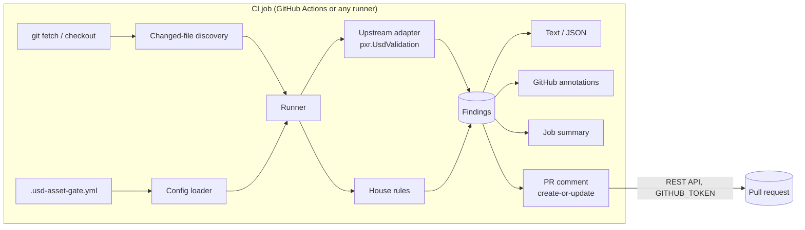

# usd-asset-gate — Architecture

> Status: planning. This is the intended design; nothing is implemented yet. API names for
> OpenUSD were checked against `usd-core` 26.8 (OpenUSD v26.08) on 2026-10-17.

## Overview



Everything to the right of "git fetch" is the Python package; everything above it is a thin
shell layer, so the same core runs from a laptop, a pre-commit hook or any CI system.

## Components

| Component | Module | Responsibility |
|---|---|---|
| CLI | `usd_asset_gate/cli.py` | `argparse` front end: `check`, `rules`, `comment`. Exit codes 0 / 1 / 2. |
| Config loader | `config.py` | Find and parse `.usd-asset-gate.yml`, validate against the schema, merge defaults and per-path overrides. |
| Discovery | `discovery.py` | Expand paths and globs; `--changed-since <ref>` via `git diff`; filter by extension and `include`/`exclude`. |
| Stage loader | `stage.py` | Open each file once (`Usd.Stage.Open`), capture composition diagnostics, compute stats once, hand a shared `AssetContext` to every rule. |
| Upstream adapter | `rules/upstream.py` | Build a `UsdValidation.ValidationContext` from the selected validators, run it, map `ValidationError` to `Finding`. |
| House rules | `rules/house/*.py` | One module per rule (`stage_metadata`, `default_prim`, `file_size`, `prim_budget`, `instance_budget`, `prim_naming`). |
| Rule registry | `rules/registry.py` | Rule IDs, defaults, parameter schemas, the alias table to upstream validators. |
| Reporters | `report/{text,json,github,summary}.py` | Render findings for each output. |
| PR commenter | `report/comment.py` | Create-or-update one PR comment with `urllib.request`. |
| Shell layer | `action.yml`, `ci/usd-asset-gate.sh` | Checkout, install, invoke the CLI; no logic beyond plumbing. |

## Data flow for one run

1. **Config.** Load `.usd-asset-gate.yml` from the repo root (or `--config`). Unknown keys or
   wrong types stop the run with exit 2 before any asset is opened.
2. **Discovery.** Resolve the file list. In PR mode: `git diff --name-only
   --diff-filter=ACMR <base>...HEAD`, keep `*.usd, *.usda, *.usdc, *.usdz`, apply
   `include`/`exclude`. Deleted files are ignored.
3. **Per file** (in a process pool; OpenUSD's own validation context also runs validators in
   parallel):
   1. `file-size` is checked from `os.stat` *before* opening, so a huge file fails fast.
   2. Open the stage with a `Tf` diagnostic delegate / error mark active so composition
      warnings ("Could not open asset …", "Could not load sublayer …") are captured rather
      than only printed.
   3. Compute `UsdUtils.ComputeUsdStageStats(stage)` once.
   4. Run the upstream adapter, then every enabled house rule, against the shared context.
4. **Collect** `Finding`s, apply severity overrides, sort by file / severity / rule.
5. **Report** to every requested output; compute the exit code from `fail_on`.

## Finding model

```python
@dataclass(frozen=True)
class Finding:
    rule: str            # "prim-budget" or "upstream:usdGeomValidators:StageMetadataChecker"
    code: str            # stable error name, e.g. "MissingUpAxisMetadata", "PrimBudgetExceeded"
    severity: Severity   # error | warning | info
    file: str            # repo-relative path of the checked root layer
    message: str
    prim_path: str | None = None
    layer: str | None = None      # layer that holds the problem, if not the root
    line: int | None = None       # .usda only, best effort
    fixer_available: bool = False # upstream fixer exists (reported, never applied)
```

`code` comes straight from `ValidationError.GetName()` for upstream findings, so users can
search OpenUSD docs for it.

## Rule engine design

- **Two rule sources, one interface.** Every rule implements
  `check(ctx: AssetContext, params) -> Iterable[Finding]`. The upstream adapter is a single
  rule source that expands into one entry per OpenUSD validator in the registry, named
  `upstream:<plugin>:<validator>`.
- **Upstream discovery is dynamic.** The adapter lists
  `UsdValidation.ValidationRegistry().GetAllValidatorMetadata()` at runtime, so new
  validators in newer `usd-core` releases appear without a release of this tool. In
  `usd-core` 26.8 the registry holds 28 validators (core, UsdGeom, UsdShade, UsdSkel,
  UsdLux, UsdPhysics, UsdUtils/usdz).
- **Aliases.** Friendly names map onto upstream validators so configs read naturally:

  | Alias | Upstream validator(s) / error names |
  |---|---|
  | `unresolved-references` | `usdUtilsValidators:MissingReferenceValidator`, `usdValidation:CompositionErrorTest` (reference errors) |
  | `unresolved-sublayers` | `usdValidation:CompositionErrorTest` (sublayer errors), `usdUtilsValidators:MissingReferenceValidator` |
  | `default-prim` | `usdValidation:StageMetadataChecker` (`MissingDefaultPrim`), plus an optional house `kind` check |
  | `stage-metadata` | `usdGeomValidators:StageMetadataChecker` (presence), plus house value checks |

  When both an alias and its upstream validator are enabled, the finding is reported once,
  under the alias.
- **House rules only add what upstream lacks.** Upstream checks that `upAxis` and
  `metersPerUnit` are *present*; the house rule checks they have the *required values*.
  Budgets, naming and file size have no upstream equivalent.
- **Severity.** Each rule has a default severity; config can override it. `fail_on`
  (default `error`) sets the threshold for exit code 1. Upstream `ValidationErrorType`
  maps Error→error, Warn→warning, Info→info.
- **Determinism.** Rules never mutate the stage; output order is stable so PR comments only
  change when findings change.

## Configuration schema

File: `.usd-asset-gate.yml` at the repository root. Every key is optional.

```yaml
version: 1

include: ["assets/**"]              # default: all USD files
exclude: ["assets/legacy/**", "**/*_wip.usda"]
fail_on: error                      # error | warning | info | never

upstream:
  enabled: true
  keywords: [UsdCoreValidators, UsdGeomValidators, UsdShadeValidators, UsdUtilsValidators]
  disable: ["usdPhysicsValidators:*"]   # names or globs

rules:
  unresolved-references: { severity: error }
  unresolved-sublayers:  { severity: error }
  default-prim:
    severity: error
    kind: component                  # optional: required Kind on the default prim
  stage-metadata:
    severity: error
    metersPerUnit: 0.01
    upAxis: Y
    tolerance: 1.0e-9
  file-size:
    severity: error
    max_bytes: { default: 50MB, .usdz: 200MB, .usda: 5MB }
  prim-budget:
    severity: warning
    max_prims: 50000
    max_by_type: { Mesh: 5000 }
  instance-budget:
    severity: warning
    max_prototypes: 200
    min_instance_ratio: 0.5          # instances / (instances + uninstanced models)
  prim-naming:
    severity: warning
    patterns:
      - match: { type: "*" }
        regex: "^[A-Za-z][A-Za-z0-9_]*$"
      - match: { type: Material }
        regex: "^M_[A-Za-z0-9_]+$"

overrides:
  - paths: ["assets/environments/**"]
    rules:
      prim-budget: { max_prims: 2000000 }
```

The schema is defined once in Python (`config.py`) and published as JSON Schema
(`schema/usd-asset-gate.schema.json`) for editor completion. Validation uses the standard
library only, so the runtime dependencies stay at `usd-core` and `PyYAML`.

## Output formats

| Output | Flag | Notes |
|---|---|---|
| Text | default | `path:prim: severity rule: message`, coloured on a TTY. |
| JSON | `--format json` | `{ "version": 1, "files": [...], "findings": [...], "summary": {...} }`; stable, documented, used by the comment step. |
| GitHub annotations | `--format github` | `::error file=<path>,line=<n>,title=<rule>::<message>` workflow commands. GitHub shows a limited number of annotations per step, so the reporter prints the most severe first and a "N more in the job summary" notice. |
| Job summary | `--summary <file>` | Appends Markdown to `$GITHUB_STEP_SUMMARY`: totals, a per-file table, collapsible details. Truncates under GitHub's per-step summary size limit with a pointer to the JSON artifact. |
| PR comment | `usd-asset-gate comment --from report.json` | One comment per PR, found by the hidden marker `<!-- usd-asset-gate:report -->` and edited with `PATCH /repos/{owner}/{repo}/issues/comments/{id}`; created with `POST …/issues/{n}/comments` if absent. When all findings clear, the comment is edited to a short "all checks pass" note, not deleted, so the history stays readable. Requires `pull-requests: write` (or `issues: write`). On `403` (for example, a PR from a fork, where `GITHUB_TOKEN` is read-only) it logs and exits 0. |

## Running in GitHub Actions

### Mode A — composite action

```yaml
- uses: actions/checkout@v7            # or the plain-git step below
  with: { fetch-depth: 0 }
- uses: Preponderous-Software/usd-asset-gate@v1
  with:
    config: .usd-asset-gate.yml
    usd-core-version: "26.8"
    comment: true
```

The composite action itself uses no other actions: it only runs `pip` and `bash`, so
pinning it by commit SHA pins everything.

### Mode B — local-only (no third-party `uses:`)

For organisations whose policy allows only actions in their own repositories. The consumer
copies `ci/usd-asset-gate.sh` into their repo (it is MIT-licensed and short enough to
review) and writes:

```yaml
on:
  pull_request:
    paths: ["**/*.usd", "**/*.usda", "**/*.usdc", "**/*.usdz", ".usd-asset-gate.yml"]
permissions:
  contents: read
  pull-requests: write
jobs:
  usd-gate:
    runs-on: ubuntu-24.04
    steps:
      - name: Checkout (plain git)
        env:
          TOKEN: ${{ github.token }}
        run: |
          git init -q .
          git remote add origin "https://github.com/${GITHUB_REPOSITORY}.git"
          git -c http.extraheader="AUTHORIZATION: basic $(printf 'x-access-token:%s' "$TOKEN" | base64 -w0)" \
            fetch -q --no-tags origin "${{ github.event.pull_request.base.sha }}" "${GITHUB_SHA}"
          git checkout -q --detach "${GITHUB_SHA}"
      - name: USD asset gate
        env:
          GITHUB_TOKEN: ${{ github.token }}
          BASE_SHA: ${{ github.event.pull_request.base.sha }}
        run: bash ci/usd-asset-gate.sh
```

`ci/usd-asset-gate.sh` then:

1. `python3 -m pip install "usd-core==${USD_CORE_VERSION:-26.8}" "usd-asset-gate==${VERSION}"`
   — or, for fully vendored use, `pip install ./vendor/usd-asset-gate` from a copied source
   tree;
2. runs `usd-asset-gate check --changed-since "$BASE_SHA" --format github
   --summary "$GITHUB_STEP_SUMMARY" --json report.json`;
3. runs `usd-asset-gate comment --from report.json` when `GITHUB_TOKEN` and a PR number are
   present;
4. exits with the `check` exit code.

The token is passed through `http.extraheader` for the fetch only and is never written into
`.git/config`.

## Dependencies

| Dependency | Version | Why |
|---|---|---|
| Python | 3.10–3.13 (CI matrix); `usd-core` 26.8 wheels exist for 3.9–3.14 | Runtime. |
| [`usd-core`](https://pypi.org/project/usd-core/) | `>=25.08` supported, `26.8` tested and default | `pxr.Usd`, `pxr.UsdUtils`, `pxr.UsdValidation`. `UsdValidation` ships in wheels from 25.02; 25.08 is where `usdchecker` made the framework its default, so it is the floor. Note: the wheel contains no `usdchecker`/`usdrecord` executables and no imaging modules. |
| [`PyYAML`](https://pypi.org/project/PyYAML/) | `>=6.0` (6.0.3 current) | Config parsing (`yaml.safe_load` only). |
| `pytest` | `>=8` (dev only) | Tests. |
| `git` | any recent | Changed-file discovery; must be on `PATH` (it is on GitHub-hosted runners). |

No other runtime dependencies: HTTP calls use `urllib.request`, schema validation is
hand-written.

## Testing strategy

- **Fixture corpus** under `tests/fixtures/`:
  - `pass/` — minimal valid assets in `.usda`, `.usdc` and `.usdz`, including a referenced
    sub-asset that resolves and an instanced set.
  - `fail/<case>/` — one defect per directory: `missing_reference`, `missing_sublayer`,
    `no_default_prim`, `no_up_axis`, `wrong_meters_per_unit`, `over_prim_budget`,
    `low_instancing`, `bad_prim_names`, `oversize_file` (generated at test time, not
    committed), `usdz_compressed`. Each has `expected.json` listing the rule IDs and codes
    that must be reported — no more, no fewer.
  - `.usdc`/`.usdz` fixtures are generated from `.usda` sources by a script in
    `tests/fixtures/build.py` so the binary files are reproducible.
- **Unit tests** per rule with in-memory stages (`Usd.Stage.CreateInMemory`) for boundary
  values (budget at N and N+1, regex edge cases, tolerance on `metersPerUnit`).
- **Golden output tests** for text, JSON, GitHub annotations and Markdown summary.
- **Comment tests** against a fake GitHub API (`http.server` in a thread) covering create,
  update, "all clear" edit and the 403 fork case.
- **Version matrix**: CI runs on the minimum and latest supported `usd-core`, so upstream
  validator changes show up as test failures rather than surprises.
- **Dogfooding**: this repository's own workflow runs the local-only mode against
  `tests/fixtures/pass/` (must pass) and `tests/fixtures/fail/` (must fail).

## Post-MVP: thumbnails

Render a thumbnail per changed asset and embed it in the PR comment. Constraints found so
far: the `usd-core` wheel includes no Hydra/imaging modules and no `usdrecord`, so rendering
needs either a full OpenUSD build (for `usdrecord`) in a container, or a separate,
non-Hydra preview path. Images cannot be attached to PR comments through the REST API, so
they would have to be uploaded as a workflow artifact or committed to a branch and linked.

## Open questions

1. **Thumbnail renderer.** Which route is acceptable: a container image with a full OpenUSD
   build and `usdrecord` (software GL), or a lightweight non-Hydra preview? And where do
   images live — artifacts (need login to view) or an orphan branch?
2. **Fork pull requests.** Commenting from forks needs `pull_request_target` or a
   `workflow_run` follow-up job. Both carry security trade-offs; the MVP just skips the
   comment on forks. Is that acceptable?
3. **Register house rules as OpenUSD validators?** `UsdValidation.ValidationRegistry` exposes
   `RegisterStageValidator` / `RegisterPrimValidator` from Python. Registering house rules
   there would make them runnable by other framework users, at the cost of coupling to an
   API that is still changing between releases. The MVP keeps its own rule interface.
4. **Optional NVIDIA rule source.** Offer `usd-validation-nvidia` as an extra
   (`pip install usd-asset-gate[nvidia]`) behind the same rule interface?
5. **Variants.** `usdchecker` exposes `--variantSets` / `--variants` and caps variant
   validation at 1000 calls by default. Should the config expose the same controls, and
   what is a sane default for CI time?
6. **Distribution.** Publish to PyPI (the name `usd-asset-gate` was unclaimed on
   2026-10-17) and the GitHub Marketplace, or ship from git only at first?
7. **Line numbers.** Mapping a prim path to a `.usda` line number needs a light text scan;
   is "file-level annotation" good enough for `.usdc`/`.usdz` and for the MVP?
