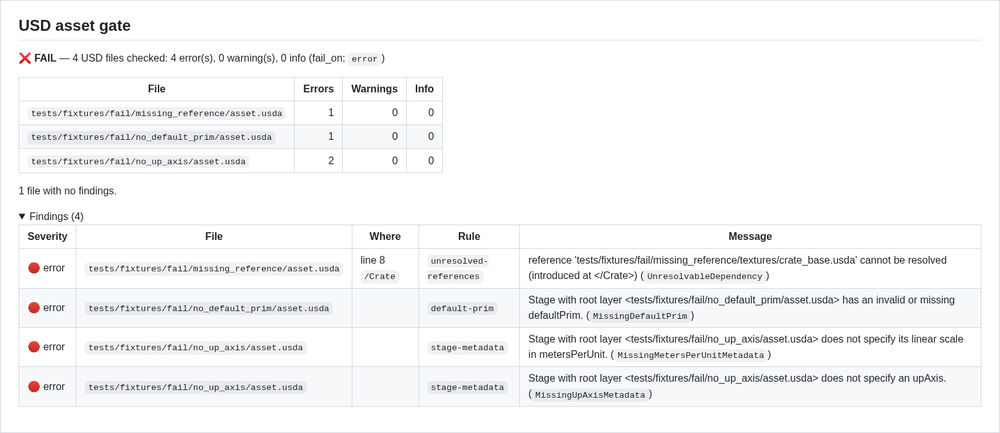
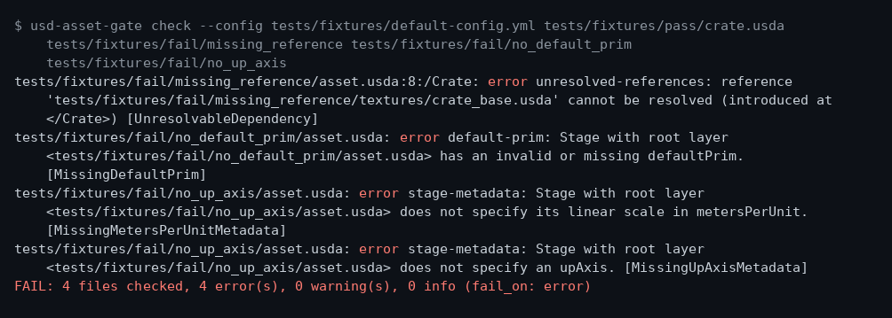
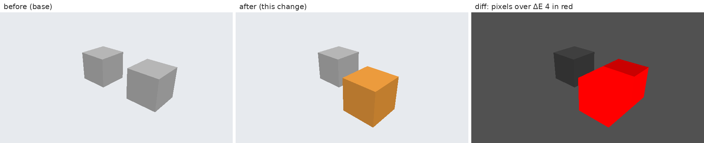

# usd-asset-gate

**usd-asset-gate** is a **CI quality gate for OpenUSD assets** — the check that stands between a broken `.usd` file and your main branch.  
It runs OpenUSD's own validators plus your **house rules** on every pull request that touches `.usd`, `.usda`, `.usdc` or `.usdz` files, and reports the results where reviewers already look.

It ships as a **plain CLI** that runs anywhere Python runs, and as a **GitHub Action** that can also be used in organisations that allow no third-party actions.



*The report the gate writes as the job summary and posts as its single PR comment, from a real run on four files in `tests/fixtures/` and rendered by GitHub's Markdown API. A live comment, edited in place from red to green, is on [#18](https://github.com/Preponderous-Software/usd-asset-gate/pull/18#issuecomment-6245303836).*

> **Status: MVP implemented.** Every MVP milestone (M1–M8) is done: the CLI, the in-process OpenUSD validators, house rules, YAML config, changed-file discovery, annotations, job summary, the single PR comment, the composite action and the local-only copy-in script. It is **not yet published** to PyPI or the GitHub Marketplace (planned after the MVP), so install it from this repository for now.

---

## 🚀 Why usd-asset-gate Exists

USD assets live in git next to code, but they rarely get the checks code gets.  
A missing reference, a stage with no default prim, an asset authored in the wrong units, or a "small prop" with half a million prims all sail through review because nobody opens the file.

OpenUSD already has the validators — `usdchecker` and the validation framework behind it — but every team has to wire them into CI by hand, and the PyPI `usd-core` wheel does not even include the `usdchecker` executable.

With usd-asset-gate:
- One YAML file sets your rules: units, up axis, budgets, naming, file sizes.
- Only the files a pull request changed are checked.
- Problems show up as annotations on the diff and as **one** PR comment that is updated in place, never spammed.
- The same command runs on your laptop before you push.

---

## 🌍 A Day in the Life with usd-asset-gate

You push a branch that updates a prop.  
Within a minute:
1. **The check goes red** because `crate.usda` references `textures/crate_base.usda`, which you forgot to commit.  
2. **An annotation on the file** says exactly which prim holds the broken reference.  
3. **The PR comment** also notes the asset is at 12,000 prims against a 5,000-prim budget.  
4. **You fix both, push again**, and the same comment flips to "all checks pass" — no pile of bot messages.

---

## 🎯 Purpose

usd-asset-gate turns OpenUSD validation into a pull-request gate with project-specific policy.

Core responsibilities:
- Running the upstream OpenUSD validators (`pxr.UsdValidation`, the framework `usdchecker` uses).
- Enforcing configurable house rules from `.usd-asset-gate.yml`.
- Scoping checks to the files a change touched.
- Reporting as text, JSON, GitHub annotations, a job summary, and a single PR comment.
- Running in locked-down CI with only `pip install usd-core` and plain `git`.

---

## 📦 Features (MVP Scope)

The MVP is defined in [`MVP.md`](MVP.md) and tracked as issues labelled `mvp`.

**Upstream checks**
- All validators registered in the installed `usd-core` (28 in 26.8), selectable by name or keyword.
- Composition errors, unresolvable references and sublayers, missing default prim, missing `upAxis` / `metersPerUnit`, usdz packaging rules, shading and geometry rules.

**House rules**
- Required `metersPerUnit` and `upAxis` values.
- Default prim present, optionally of a given `kind`.
- File-size limits per extension.
- Prim-count and instancing budgets.
- Prim naming conventions by regex.

**CI integration**
- Changed-files mode (`--changed-since <ref>`).
- GitHub annotations and job summary.
- One PR comment, created once and edited in place (skipped on PRs from forks, where the log and job summary still show the results).
- Composite action, or a copy-in script with **no third-party `uses:`**.

**Planned after the MVP**
- Publishing to PyPI (`usd-asset-gate`) and listing the action on the GitHub Marketplace.
- Thumbnails of changed assets in the PR comment, rendered by `usdrecord` in an optional full-OpenUSD Docker image.

**Visual diffs (advisory, opt-in)**
- `usd-asset-gate preview`: before/after images of changed assets, rendered headless by [Strata](https://github.com/Preponderous-Software/strata), with a ΔE diff and a "Visual changes" section in the job summary and PR comment. Never fails the check. See [Visual diffs](#visual-diffs-advisory).
- NVIDIA `usd-validation-nvidia` as an optional extra rule source (`pip install usd-asset-gate[nvidia]`).

> For the full design, see [`ARCHITECTURE.md`](ARCHITECTURE.md). For the problem, audience and prior art, see [`CONCEPT.md`](CONCEPT.md).

---

## 🛠 Tech Stack

- Python 3.10+
- [`usd-core`](https://pypi.org/project/usd-core/) (OpenUSD Python bindings; 26.8 targeted)
- PyYAML (configuration)
- Python standard library for everything else (GitHub API calls included)
- pytest (tests)
- Bash + GitHub Actions composite action (CI packaging)

---

## 📂 Project Structure

Layout:

usd-asset-gate/  
 ├── usd_asset_gate/          # Python package  
 │    ├── cli.py              # check / rules / comment subcommands  
 │    ├── model.py            # Finding, Severity, Report  
 │    ├── runner.py           # runs rules over files, collects findings  
 │    ├── stage.py            # opens each stage once, captures diagnostics  
 │    ├── config.py           # .usd-asset-gate.yml loader and schema  
 │    ├── discovery.py        # paths, globs, changed-since-ref  
 │    ├── rules/              # upstream adapter (upstream.py) and house rules  
 │    ├── preview/            # advisory visual diffs: USD → triangles, Strata, ΔE  
 │    └── report/             # text, JSON, annotations, summary, PR comment  
 ├── schema/                 # JSON Schema for .usd-asset-gate.yml  
 ├── ci/usd-asset-gate.sh     # copy-in script for local-only CI  
 ├── action.yml               # composite GitHub Action  
 ├── examples/                # workflows for both modes  
 ├── tests/fixtures/          # USD files that must pass or fail  
 ├── CONCEPT.md               # Problem, audience, non-goals, prior art  
 ├── MVP.md                   # MVP scope, acceptance criteria, milestones  
 ├── ARCHITECTURE.md          # Components, rule engine, config, outputs  
 └── README.md                # This file  

---

## 🚀 Getting Started

Until the PyPI release, install from the repository (pin a commit for CI):

```bash
python -m venv .venv && . .venv/bin/activate      # Python 3.10+
pip install usd-core "git+https://github.com/Preponderous-Software/usd-asset-gate@main"

usd-asset-gate check assets/                                   # files or directories
usd-asset-gate check --changed-since origin/main --format github \
  --summary "$GITHUB_STEP_SUMMARY" --json report.json           # what CI runs
usd-asset-gate rules                                           # every rule and its setting
usd-asset-gate comment --from report.json                      # the one PR comment (in CI)
```

The same run in a terminal (`--format text`, the default):



Both images are regenerated from the fixtures by [`docs/capture_readme.py`](docs/capture_readme.py).

Exit codes: `0` pass, `1` findings at or above `fail_on`, `2` usage or config error.

Add a `.usd-asset-gate.yml` at the repository root to set house rules (every key is
optional; the full schema is in [`ARCHITECTURE.md`](ARCHITECTURE.md#configuration-schema)
and [`schema/usd-asset-gate.schema.json`](schema/usd-asset-gate.schema.json)):

```yaml
version: 1
include: ["assets/**"]
rules:
  stage-metadata: { metersPerUnit: 0.01, upAxis: "Y" }
  default-prim: { kind: component }
  file-size: { max_bytes: { default: 50MB, .usdz: 200MB } }
  prim-budget: { max_prims: 5000 }
```

**In GitHub Actions**, pick one:

- **Composite action** — [`examples/workflow-action.yml`](examples/workflow-action.yml):
  `uses: Preponderous-Software/usd-asset-gate@<commit-sha>` after a checkout that reaches
  the PR's base commit. The action runs only `bash` and `pip`.
- **Local-only, no `uses:` at all** — copy [`ci/usd-asset-gate.sh`](ci/usd-asset-gate.sh)
  into your repository and use [`examples/workflow-local-only.yml`](examples/workflow-local-only.yml),
  which checks out with plain `git` (the token travels as a one-off `http.extraheader` and
  is never written to `.git/config`).

Both run on `pull_request` (never `pull_request_target`); on pull requests from forks the
comment is skipped and the results stay in the log, annotations and job summary.

### Visual diffs (advisory)

`usd-asset-gate preview` shows a reviewer what an asset change looks like. It renders each
changed USD file as it was at the base and as it is now, from the same cameras, headless with
[Strata](https://github.com/Preponderous-Software/strata) on Mesa's software rasterizer, and
compares the two with Strata's golden-image ΔE policy:



That is a real run on the gate's own `tests/fixtures/pass/yard.usda`, with one crate moved and
recoloured, regenerated by [`docs/capture_preview.py`](docs/capture_preview.py). It is opt-in
and advisory: it exits 0 whatever the images show, and when Strata cannot start it reports
"preview unavailable" instead of failing.

```bash
pip install usd-core "usd-asset-gate[preview] @ git+https://github.com/Preponderous-Software/usd-asset-gate@main"
curl -fsSLO https://github.com/Preponderous-Software/strata/releases/download/v0.4.0/libstrata-0.4.0-linux-x64.so
echo "6044127f21c33abbd03d4e39182b5a6082c73e92479236bbd0aea6e68594b181  libstrata-0.4.0-linux-x64.so" | sha256sum -c -
sudo apt-get install -y libegl1 libegl-mesa0 libgl1-mesa-dri           # EGL + llvmpipe
export STRATA_LIBRARY=$PWD/libstrata-0.4.0-linux-x64.so LIBGL_ALWAYS_SOFTWARE=1 GALLIUM_DRIVER=llvmpipe

usd-asset-gate preview --changed-since origin/main --out previews/ --json previews.json \
  --summary "$GITHUB_STEP_SUMMARY"
usd-asset-gate comment --from report.json --previews previews.json  # adds "Visual changes"
```

Turn it on in the config (`preview` needs `version: 2`; every key but `enabled` is optional):

```yaml
version: 2
preview:
  enabled: true
  views: [three_quarter, three_quarter_back]   # also: top, front
  size: [640, 360]
  max_triangles: 2000000
  threshold: 4.0       # ΔE a pixel must exceed to count
  max_fraction: 0.005  # up to this share of pixels is "no visible change"
```

It draws meshes, the implicit gprims and point instancers in flat display colours. It does not
draw subdivision, curves, points, volumes, skinning, textures, opacity or scene lights, so "no
visible change" does not mean "renders the same in Storm". Linux x64 only. The faithful
`usdrecord` thumbnails stay planned beside it; see
[ARCHITECTURE.md](ARCHITECTURE.md#preview-strata-headless-advisory).

---

## 📄 License

This project is licensed under the MIT License — see [`LICENSE`](LICENSE).  

**Copyright © 2026 Daniel McCoy Stephenson.**

---

## 📬 Contact

For inquiries, feature requests, or contributions, please open an issue in the GitHub repository:  
https://github.com/Preponderous-Software/usd-asset-gate
